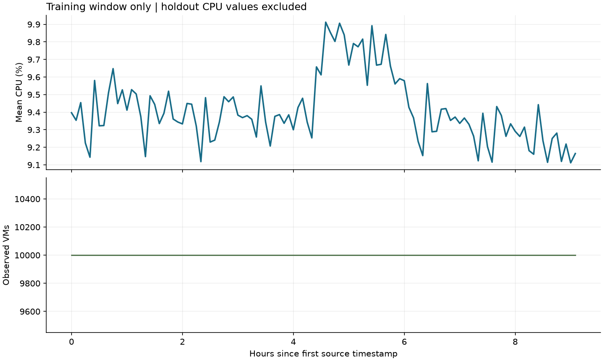
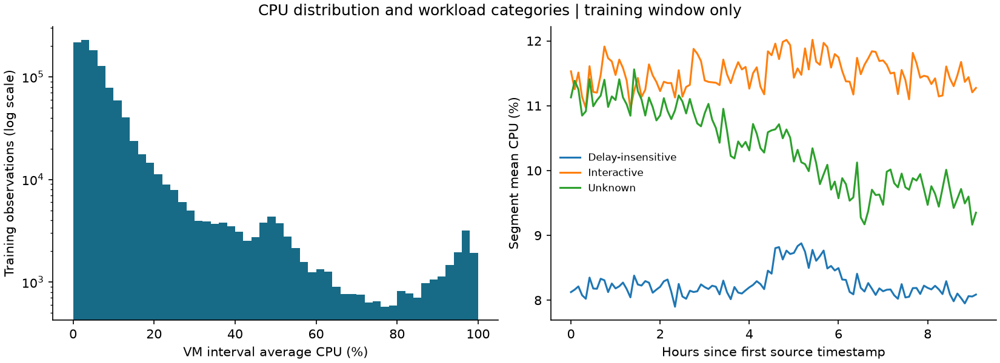

# Data audit and initial workload analysis

Reproduce with `python -m cwfc.audit --data challenge_data --output reports/analysis`.
This is an initial analysis, not the final submission report. No forecasting
model has been fitted or selected, and holdout CPU targets are not summarized,
plotted, or exported. Full-release checks concern structural integrity only.

## Source integrity and preprocessing

- CPU observations: 1,340,000; VMs: 10,000.
- Metadata records: 10,000; VM populations match exactly.
- Shared timestamp grid: 134 observations, from
  0 to 39900 source-relative seconds,
  at exactly 300-second cadence.
- Each VM has 134 observations on that shared grid.
- No missing values, duplicate VM/timestamp keys, duplicate metadata VM IDs,
  missing grid positions, nonfinite CPU readings, out-of-range CPU percentages,
  or violations of `min_cpu <= avg_cpu <= max_cpu`.
- No rows were filled, removed, deduplicated, or resampled. The implementation
  fails on such defects so any future repair must be deliberate and documented.
- Timestamps remain numeric seconds. There is no asserted real calendar date,
  weekday, timezone, or hour of day.

## Targets and the protected holdout

The full target series is constructed first by counting distinct VM IDs and
taking an unweighted mean of their `avg_cpu` values at each timestamp. The CPU
target is already expressed in percent; it is not core-weighted or total CPU
capacity consumed. No core-count approximation is used.

Training uses 110 observations from 0 to 32700 seconds.
The 24 holdout timestamps run from 33000
to 39900 seconds. Only their timestamps are exported.
The forecast horizon is 24 steps, or
120 minutes from the forecast origin.
The difference between its first and last timestamps is
115 minutes.

## Active VMs, lifetimes, and sampling limitations

Every timestamp has 10,000 observed VMs. The active-count target
is therefore constant in this release. This follows the documented selection
of complete VM traces and does not demonstrate that the upstream cloud fleet
has no churn. We observe no VM arrivals or departures within the selected grid.
A persistence baseline is an appropriate candidate for this target; no
holdout performance claim is made here.

Metadata creation/deletion checks relative to the training window:

| check | VMs |
| --- | --- |
| created_before_window | 0 |
| created_at_window_start | 10000 |
| created_during_training | 0 |
| deleted_during_training | 0 |

Creation times at zero may be boundary-censored; the data contract does not
establish their censoring semantics. Likewise, a recorded deletion time beyond
the observed window does not establish a complete observed lifetime. We do not
infer population-wide lifetime distributions from this selected cohort.

## Training-window CPU behavior

- Aggregate mean CPU: 9.4141%; minimum: 9.1116%; maximum: 9.9122%.
- Aggregate standard deviation: 0.1936 percentage points.
- First versus last training observation: 9.3969% and 9.1646%.
- Largest absolute five-minute aggregate change: 0.4368 percentage points.
- Lag-one autocorrelation: 0.6672358236125617.
- Zero CPU readings: 0.00% of training observations.
- Readings at or above 80%: 1.27%.
- VMs with training mean below 5%: 46.35%.
- VMs with training mean at least 80%: 0.99%.

Distribution across VM-level training observations:

| quantile | CPU (%) |
| --- | --- |
| 0.0000 | 0.0072 |
| 0.2500 | 2.4869 |
| 0.5000 | 5.1198 |
| 0.7500 | 9.6480 |
| 0.9000 | 19.6911 |
| 0.9500 | 37.2932 |
| 0.9900 | 87.4063 |
| 1.0000 | 99.4880 |

### Highest training demand timestamps

| timestamp | active_vm_count | aggregate_cpu_utilization |
| --- | --- | --- |
| 16500 | 10000 | 9.9122 |
| 17400 | 10000 | 9.9062 |
| 19500 | 10000 | 9.8919 |
| 16800 | 10000 | 9.8540 |
| 20400 | 10000 | 9.8422 |

### Lowest training demand timestamps

| timestamp | active_vm_count | aggregate_cpu_utilization |
| --- | --- | --- |
| 32400 | 10000 | 9.1116 |
| 30900 | 10000 | 9.1143 |
| 27300 | 10000 | 9.1154 |
| 8400 | 10000 | 9.1185 |
| 31800 | 10000 | 9.1196 |

These ranks identify peaks in the training window only. A narrow aggregate
CPU range can coexist with heavily loaded individual VMs; a fleet average
alone cannot determine which VMs can safely be downsized.

## Workload segments

All CPU summaries below are recomputed from training readings. The metadata
CPU fields `avg_cpu`, `max_cpu`, and `p95_max_cpu` are excluded because their
time coverage is not established. Core and memory buckets are used as labels,
not exact hardware capacities. Category and hardware labels are descriptive;
their availability at forecast origin would need justification before modeling.

| dimension | segment | vm_count | mean_cpu_pct |
| --- | --- | --- | --- |
| vm_category | Delay-insensitive | 6180 | 8.2573 |
| vm_category | Interactive | 3091 | 11.5051 |
| vm_category | Unknown | 729 | 10.3547 |
| virtual_core_bucket | 2 | 7534 | 9.7642 |
| virtual_core_bucket | 24 | 62 | 11.4288 |
| virtual_core_bucket | 4 | 1908 | 7.9187 |
| virtual_core_bucket | 8 | 486 | 9.6584 |
| virtual_core_bucket | >24 | 10 | 6.6195 |
| memory_gb_bucket | 2 | 3904 | 8.8023 |
| memory_gb_bucket | 32 | 1383 | 7.8140 |
| memory_gb_bucket | 4 | 2475 | 11.4595 |
| memory_gb_bucket | 64 | 82 | 11.2172 |
| memory_gb_bucket | 8 | 2146 | 9.1434 |
| memory_gb_bucket | >64 | 10 | 6.6195 |

The highest category mean is Interactive at
11.5051%, versus Delay-insensitive at
8.2573%. Their difference is
3.2479
percentage points. This supports monitoring workload classes separately rather
than treating the fleet average as a typical individual workload.

Differences between segment means can be hidden by a fleet average. Segment
monitoring can help identify a loaded workload class even when overall demand
is stable. Category/core stratification and complete-trace selection mean this
cohort should not be assumed representative of Azure's full VM population.

## Consequences for modeling and operations

1. Start with persistence and recent moving-average baselines. The constant
   active-count target must be reported honestly; forecasting it does not
   establish general capability to forecast VM churn.
2. There are only 110 training timestamps. Daily and weekly seasonality
   cannot be established from this window. Local changes and short-lag
   autocorrelation are descriptive, not proof of a recurring cycle.
3. Compare candidate CPU models using expanding training windows and a
   24-step validation horizon entirely inside the first 110
   observations. Choose the model before evaluating final holdout labels.
4. Keep deletion timestamps and source-wide CPU summaries out of forecasting
   features unless their information availability can be proved.
5. A capacity policy needs forecast-error evidence and explicit headroom.
   Unweighted average utilization is insufficient to calculate total required
   cores or justify a specific scaling threshold on its own.

No model accuracy, capacity threshold, or final operational policy is selected
by this audit. Those require the next validation and modeling stage.
