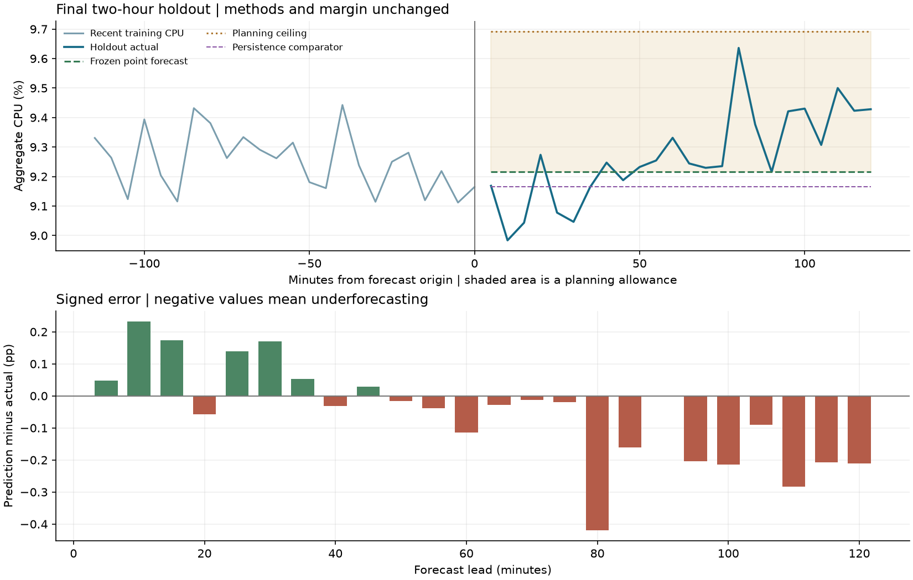

# Final holdout evaluation

The saved predictions were verified against their pre-evaluation hash and
the frozen training-only forecasting method before scoring. The source data,
operational plan, prediction implementation, training fingerprint, and frozen
configuration also match their generation records. **Predictions, model
parameters, and the headroom margin are unchanged.** This is final scoring,
not an opportunity to choose a new model or recalibrate on test errors.

## Protocol and comparison

- Training: 110 observations; origin: 32700 seconds.
- Final holdout: 24 observations, 33000 through
  39900 source-relative seconds.
- The selected CPU forecast is scored directly from `predictions.csv`.
  Other original baseline comparators are calculated using training data only
  and forecast the identical timestamps. The 12-reading moving average is
  represented by `frozen_submission`, without a duplicate recomputed row.
- The peak threshold is the 90th percentile of training CPU, fixed at the
  forecast origin. Holdout values are used only as labels for scoring.
- No new candidate models, windows, thresholds, or margins are selected here.

## CPU accuracy

| model | mae | rmse | bias | nmae_pct_training_mean | mae_improvement_pct | peak_n | peak_mae | peak_bias |
| --- | --- | --- | --- | --- | --- | --- | --- | --- |
| frozen_submission | 0.1230 | 0.1613 | -0.0526 | 1.3066 | 16.1997 | 0 | N/A | N/A |
| persistence | 0.1468 | 0.1848 | -0.1044 | 1.5592 | 0.0000 | 0 | N/A | N/A |
| moving_average_3 | 0.1466 | 0.1846 | -0.1041 | 1.5570 | 0.1403 | 0 | N/A | N/A |
| moving_average_6 | 0.1336 | 0.1713 | -0.0781 | 1.4188 | 9.0050 | 0 | N/A | N/A |
| moving_average_24 | 0.1169 | 0.1537 | -0.0195 | 1.2418 | 20.3569 | 0 | N/A | N/A |

CPU errors and bias are in percentage points. Bias is prediction minus
actual. Normalized MAE divides absolute errors by the mean absolute training
target and multiplies by 100, avoiding pointwise near-zero denominators. A
zero training scale or perfect persistence reference yields N/A for the
corresponding normalized/relative metric.

The frozen CPU model has MAE **0.1230**, RMSE **0.1613**,
and signed bias **-0.0526** percentage points. Its MAE is **16.20% lower than persistence** on this holdout.
The comparison is reported without changing the selected method.

On this test window, the following pre-existing comparators have lower MAE: `moving_average_24` (0.1169). This test outcome is retained transparently. The submission stays with the method selected on development folds; no switch is made after seeing labels.

Observed holdout CPU mean is 9.2690%,
with range 8.9836% to
9.6360%.

No holdout CPU observation reaches the training-derived peak threshold of 9.6684%. Peak metrics are N/A. This holdout does not test the model's ability to handle a comparable high-load regime; the poor peak behavior found in development remains relevant.

## Error progression and highest observed loads

| lead_start | lead_end | n | mae | rmse | bias |
| --- | --- | --- | --- | --- | --- |
| 1 | 6 | 6 | 0.1366 | 0.1516 | 0.1176 |
| 7 | 12 | 6 | 0.0468 | 0.0569 | -0.0197 |
| 13 | 18 | 6 | 0.1067 | 0.1840 | -0.1065 |
| 19 | 24 | 6 | 0.2019 | 0.2097 | -0.2019 |

Highest three holdout CPU values, reported descriptively without redefining peaks:

| timestamp | lead | actual | prediction | error | is_peak |
| --- | --- | --- | --- | --- | --- |
| 37500 | 16 | 9.6360 | 9.2164 | -0.4196 | False |
| 39300 | 22 | 9.5000 | 9.2164 | -0.2836 | False |
| 38700 | 20 | 9.4302 | 9.2164 | -0.2139 | False |

A fixed level cannot follow newly developing changes after the origin.
The first lead block has signed bias +0.1176, versus
-0.2019 percentage points in the final block. The largest
absolute error is an underprediction of 0.4196 percentage
points at lead 16 (timestamp 37500).
One two-hour window does not establish a general
horizon/error relationship. Development validation remains the broader
available evidence across workload regimes.



## Active VM count

| model | n | mae | rmse | bias |
| --- | --- | --- | --- | --- |
| frozen_submission | 24 | 0.0000 | 0.0000 | 0.0000 |

The selected complete-trace VM cohort stays constant. Exact count forecasts
therefore demonstrate consistency with the curated target, not general
churn prediction. Relative improvement over a zero-error persistence
reference is undefined and remains N/A.

## Frozen headroom policy

- Additive margin: **0.47602978 percentage points**, unchanged.
- Covered readings: **24/24 (100.00%)**.
- Entire two-hour horizon covered: **True**.
- Ceiling breaches: **0**; peak breaches: **N/A (no peak observations)**.
- Two-consecutive-breach review events: **0**;
  timestamps: `[]`.
- Maximum exceedance above the ceiling: **0.0000 percentage points**.
- Mean positive unused allowance: **0.4234 percentage points**.
- Largest point-forecast underprediction: **0.4196 percentage points**.
- Minimum ceiling-minus-actual gap: **0.0564 percentage points**
  (negative would indicate a breach).

These are realized diagnostics for one holdout. Empirical point coverage is
not a calibrated probability or a guarantee for future complete horizons.
The positive ceiling-minus-actual gap is a utilization-budget proxy, not
measured infrastructure cost. No hardware allocation or automatic scaling
action is inferred, and no external alert is sent by this evaluator.

## Reproduction and artifact integrity

Install the analysis extra for the chart, then score the saved artifacts:

```bash
python -m pip install -e ".[analysis]"
python -m cwfc.evaluate --data challenge_data --predictions predictions.csv --generation-reports reports/forecast --output reports/evaluation
```

`holdout_errors.csv` preserves each actual, prediction, signed error, origin,
lead, and peak flag. `holdout_policy_rows.csv` records each ceiling breach
and review event. The JSON summary links the scored prediction hash to the
earlier generation record and freeze. Historical prediction-generation
records keep their original pre-scoring status; this separate evaluation
record documents that labels have now been examined for scoring only.

All protected inputs are unchanged after evaluation. Final-report conclusions
must include these outcomes and limitations; the model and policy stay frozen.
