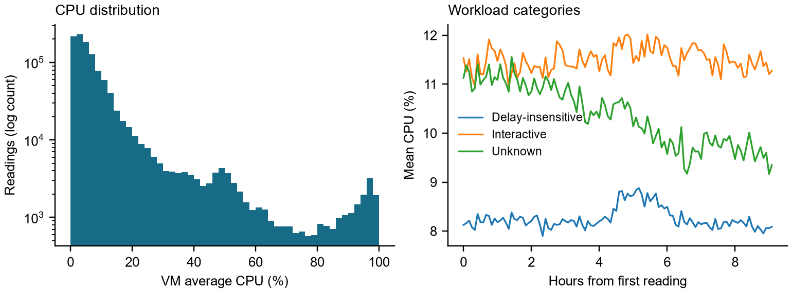
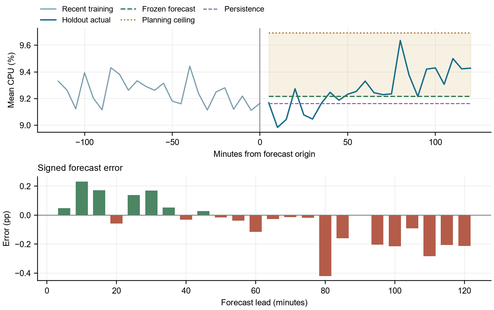

# Cloud Workload Forecasting and Analysis

Final report for Atomity

**Salar Rahnama**  
[Salarrahnama0001@Gmail.com](mailto:Salarrahnama0001@Gmail.com)  
2 November 2026

## Executive summary

I found that a simple forecast is a useful reference for this workload, provided its limitations are made explicit. I selected a 60-minute moving average for aggregate CPU utilization and persistence for active VM count. On the final two-hour holdout, the CPU forecast achieved a mean absolute error of **0.1230 percentage points**, compared with **0.1468** for persistence, a **16.2% reduction**. Its root mean squared error was **0.1613 percentage points**. The VM-count forecast was exact because the curated population remained constant at 10,000 VMs.

I selected the methods using chronological validation inside the first 110 observations and froze the configuration before generating the final 24 predictions. A 120-minute moving average subsequently performed better on the holdout, with MAE of 0.1169 percentage points. I have reported that result and retained the original selection. Changing the method after inspecting test labels would invalidate the evaluation protocol.

For operations, I recommend an advisory CPU planning ceiling that adds **0.4760 percentage points** to the point forecast. This allowance covered all 24 holdout readings. It is an empirical margin derived from development errors, and I do not interpret it as a guaranteed prediction interval or evidence that aggregate utilization alone can determine hardware capacity.

## Data understanding and preprocessing

I used the supplied **data-v1** release of the Microsoft Azure Public Dataset V2 subset. It contains 1,340,000 CPU readings from 10,000 VMs and one metadata record per VM. Each VM has 134 readings on the same five-minute grid, from source-relative timestamp 0 to 39,900 seconds, an observed span of about 11.1 hours. I verified the three release checksums before analysis.

My audit found no missing values, duplicate VM/timestamp pairs, duplicate metadata IDs, irregular intervals, or mismatched VM populations. All CPU values were finite percentages in [0, 100] and satisfied minimum <= average <= maximum. I therefore kept the original cadence and made no imputations or row removals. The pipeline stops on these defects rather than silently repairing them.

I constructed **active_vm_count** as the number of distinct VMs with a valid CPU observation at each timestamp. I constructed **aggregate_cpu_utilization** as the unweighted mean of the VM-level average CPU readings. Each VM contributes equally, so this target describes average utilization rather than total consumed cores. I retained timestamps as relative seconds and made no assumption about a real calendar date or weekday.

<!-- pagebreak -->

## Workload analysis

I restricted exploratory CPU summaries to the first 110 timestamps. In that window, aggregate CPU averaged **9.4141%**, with a minimum of **9.1116%**, a maximum of **9.9122%**, and standard deviation of **0.1936 percentage points**. The highest training value occurred at timestamp 16,500 seconds; the lowest occurred at 32,400 seconds. The largest absolute five-minute change was 0.4368 percentage points.

The fleet average conceals a much wider range of VM behavior. The median VM-level training reading was 5.12%, while its 99th percentile was 87.41%. Of the selected VMs, **46.35%** had a training mean below 5%, and **99 VMs** had a training mean of at least 80%. I would investigate those heavily loaded VMs before interpreting the low aggregate mean as an opportunity to reduce capacity.

| Workload category | VMs | Training mean CPU |
| --- | ---: | ---: |
| Delay-insensitive | 6,180 | 8.2573% |
| Interactive | 3,091 | 11.5051% |
| Unknown | 729 | 10.3547% |

Interactive workloads averaged 3.2479 percentage points more CPU than delay-insensitive workloads. I also compared core and memory buckets; their training means ranged from 6.62% to 11.46%. I treated buckets as segment labels, since the open-ended categories do not provide exact hardware capacities. These differences support monitoring workload classes separately.



*Figure 1. VM-level training readings have a long upper tail. Category time series show behavior that a single fleet average can hide. All plotted values precede the final holdout.*

Lag-one aggregate autocorrelation was 0.6672, supporting a comparison of recent-history models. I observed a temporary rise in the delay-insensitive series, but this short window cannot establish daily or weekly recurrence. The decline in the Unknown category also suggests that a single fixed level will not capture every segment equally well.

Every selected VM appears at every timestamp, so the active-count target is constant. The data card explains that only complete traces were eligible for selection. I observed no arrivals or departures within this cohort; that does not establish an absence of churn in the original cloud fleet. Creation timestamps were all zero, and no deletion occurred during training. I did not infer uncensored VM lifetimes from those boundary values.

<!-- pagebreak -->

## Forecasting approach

I started with persistence and moving averages over the last 3, 6, 12, and 24 readings, corresponding to 15, 30, 60, and 120 minutes. Each method produces its entire two-hour forecast at one origin. I did not update a forecast with actual values from inside its forecast horizon.

I then compared three small CPU models. For simple exponential smoothing, I fixed alpha at 0.2 and initialized the level from the first training reading. For a local damped trend, I fitted a line to the last 12 readings and reduced each successive future slope contribution by a factor of 0.8. For AR(1), I fitted an intercept and one lag coefficient on the available history, constrained the coefficient to [-0.95, 0.95], and forecast recursively using predicted values. Candidate outputs were bounded to [0, 100].

I fixed this candidate set before scoring it and did not run a hyperparameter search. With 110 aggregate training points, I preferred a comparison that I could inspect and reproduce over a large search whose ranking would be difficult to trust. My final CPU method averages the last 12 observed aggregate readings once and repeats that value across all 24 leads. For VM count, I retained persistence because all baseline methods tied at zero development error.

## Validation methodology

I constructed the complete target series first, then separated the first **110 observations** from the final **24-observation holdout**. Model comparison used three expanding histories entirely within those 110 observations.

| Fold | Training observations | Training end | Validation timestamps |
| --- | ---: | ---: | --- |
| 1 | 38 | 11,100 | 11,400 to 18,300 |
| 2 | 62 | 18,300 | 18,600 to 25,500 |
| 3 | 86 | 25,500 | 25,800 to 32,700 |

*All timestamps are source-relative seconds. Each validation block contains 24 readings and begins five minutes after its forecast origin.*

This design provides 72 nonoverlapping validation timestamps while matching the required two-hour forecast horizon. Earlier validation observations become legitimate history at later origins. I used the same folds for all methods and pooled individual errors, rather than averaging fold RMSE values.

I ranked models primarily by MAE and also examined RMSE, signed bias, and peak errors. Bias is prediction minus actual. My normalized MAE divides absolute errors by that fold's mean absolute training target and multiplies by 100; it avoids dividing by individual near-zero actuals. Relative improvement is 100 x (1 - model MAE / persistence MAE). I report undefined ratios as N/A when persistence error or the normalization scale is zero.

I defined a peak as an observed evaluation reading at or above the 90th percentile of its training history. Each threshold was fixed at its origin. I excluded metadata CPU summaries because their time coverage is unclear, and I did not use deletion times or future readings as predictors. Before final prediction generation, I saved the selected methods, parameters, headroom margin, training fingerprint, and source hashes in a checked freeze record.

<!-- pagebreak -->

## Model comparison

The table below summarizes CPU development errors over the same 72 validation timestamps. All errors are in percentage points; lower is better.

| Method | MAE | RMSE | Peak MAE |
| --- | ---: | ---: | ---: |
| Persistence | 0.2082 | 0.2684 | 0.2714 |
| Moving average 15 minutes | 0.1989 | 0.2515 | 0.2446 |
| Moving average 30 minutes | 0.2140 | 0.2690 | 0.2384 |
| Moving average 60 minutes | **0.1784** | 0.2322 | 0.2864 |
| Moving average 120 minutes | 0.2077 | 0.2496 | 0.3357 |
| Exponential smoothing | 0.1948 | 0.2462 | 0.2631 |
| Local damped trend | 0.2987 | 0.3814 | 0.2711 |
| Stable AR(1) | 0.1817 | **0.2243** | 0.3236 |

I selected the 60-minute average because it had the lowest pooled MAE, improving on persistence by **14.3%**. AR(1) had lower RMSE, but its MAE was slightly higher and its peak underprediction was more pronounced. Across the 16 development peaks, the selected method had bias of -0.2848 percentage points, versus -0.3236 for AR(1). I therefore kept peak risk separate from the point-forecast objective.

The fold results also exposed weaknesses that aggregate rankings hide. The selected average was slightly worse than persistence in fold 1, then improved MAE by 26.1% and 10.1% in folds 2 and 3. The damped trend's fold 2 MAE and positive bias were both 0.5458 percentage points: it continued the preceding rise into a reversal. I did not adjust its damping after inspecting that failure.

## Final holdout results

After freezing the methods, I generated the final forecasts from training data only and saved them before scoring. The CPU point forecast was **9.21636953%** at each lead; the VM-count forecast was **10,000**.

| CPU method | Holdout MAE | Holdout RMSE | Signed bias |
| --- | ---: | ---: | ---: |
| Selected 60-minute average | **0.1230** | **0.1613** | -0.0526 |
| Persistence | 0.1468 | 0.1848 | -0.1044 |
| Moving average 15 minutes | 0.1466 | 0.1846 | -0.1041 |
| Moving average 30 minutes | 0.1336 | 0.1713 | -0.0781 |
| Moving average 120 minutes | 0.1169 | 0.1537 | -0.0195 |

The selected method reduced holdout MAE by **16.2%** against persistence, with normalized MAE of **1.3066%** of mean training utilization. The 120-minute average did better on this particular test window. I retained the preselected method and report that comparison without treating the holdout as another selection fold. VM-count MAE and RMSE were both zero, reflecting the constant curated population.

<!-- pagebreak -->

## Forecast errors

The holdout CPU target averaged 9.2690% and ranged from 8.9836% to 9.6360%. My fixed forecast initially overpredicted several low readings, then increasingly underpredicted as utilization rose. It underpredicted 16 of the 24 observations. The largest absolute error was **0.4196 percentage points**, at lead 16, 80 minutes after the origin.



*Figure 2. I scored the saved forecast without updates. The shaded area is the separate planning allowance above the point forecast, not a calibrated prediction interval. Negative errors indicate underprediction.*

| Forecast leads | Elapsed minutes | MAE | Signed bias |
| --- | --- | ---: | ---: |
| 1 to 6 | 5 to 30 | 0.1366 | +0.1176 |
| 7 to 12 | 35 to 60 | 0.0468 | -0.0197 |
| 13 to 18 | 65 to 90 | 0.1067 | -0.1065 |
| 19 to 24 | 95 to 120 | 0.2019 | -0.2019 |

The final six errors were all underpredictions. This is the main limitation of the selected method: averaging reduces sensitivity to a noisy final reading, but a constant level cannot follow a change that develops after the origin. The single test window is too short to establish how error normally grows with lead time.

No holdout observation reached the training-derived peak threshold of **9.6684%**. I therefore report holdout peak metrics as N/A. The successful overall score does not resolve the peak underprediction seen during development, where the selected method's peak MAE was 0.2864 percentage points. That distinction matters when interpreting the operational policy.

<!-- pagebreak -->

## Operational recommendation

I recommend a two-hour planning ceiling equal to the CPU point forecast plus **0.47602978 percentage points**, capped at 100%. I calculated this fixed allowance as the nonnegative 95th percentile of the selected method's 72 development underprediction errors, using the higher empirical quantile. I froze it before scoring the holdout and kept it separate from the submission's point forecasts.

The final ceiling was **9.6924%**. It covered all 24 holdout readings, with no ceiling breaches or review events. The smallest gap above actual demand was **0.0564 percentage points**, and the mean positive unused allowance was 0.4234 percentage points. These are utilization-budget measures, not observed hardware costs. On the reused development residuals, the allowance covered 69/72 readings but only 2/3 complete horizons, with three peak breaches. Prior-fold-only calibration checks covered the two later development windows; that small sample does not establish reliable coverage.

I would retain current capacity and use the ceiling as an advisory demand budget. If the team supplies a sustainable utilization budget for the same cohort, I would initiate a capacity review before the forecast ceiling reaches it. Two consecutive five-minute readings strictly above their issued ceilings would also trigger a workload and host review. I would emit one event on the second breach and reset the breach run when demand returns to or below the ceiling.

I would inspect loaded VMs and workload segments before changing resources. More allowance reserves unused utilization budget; less allowance increases exposure to underprediction. The data does not provide SLO costs, host placement, scaling latency, or exact core capacity, so I cannot justify a cost-optimal margin or automatic scaling action. In production I would refresh forecasts every five minutes; the benchmark evaluation remains a single fixed-origin forecast.

## Limitations and future work

My conclusions apply to a stratified, complete-trace cohort over roughly 11 hours, with only three development origins and one final holdout. They do not establish daily seasonality, general fleet churn behavior, or guaranteed interval coverage. I would next obtain longer traces with arrivals and departures, evaluate across more origins and peak regimes, and add core-weighted demand and host constraints. I would assess segment forecasts and margins on new validation periods before considering deployment changes, while preserving this test result unchanged.

## Reproducibility and sources

I implemented the pipeline in `src/cwfc`, documented the commands in the README, and verified **70 passing tests**. Tests cover temporal splits, known forecast calculations, holdout isolation, small input populations, submission schema, and frozen-artifact integrity. From a clean checkout, with the verified release under `challenge_data/`, I reproduce the submission and its evaluation with:

```bash
python -m pip install -r requirements-lock.txt
python -m pip install --no-deps -e .
python scripts/reproduce.py
python -m pytest -q
```

The run records preserve input and output hashes. I verified that scoring left the prediction file, frozen configuration, and margin unchanged. Detailed evidence is in `analysis/data_audit.json`, `validation/model_comparison_cpu_metrics.csv`, `policy/headroom_diagnostics.json`, and `evaluation/holdout_evaluation.json` under `reports/`.

Source attribution: [Microsoft Azure Public Dataset V2](https://github.com/Azure/AzurePublicDataset), distributed here through the [Atomity data-v1 release](https://github.com/atomityhq/forecasting-challenge/releases/tag/data-v1) and its bundled data card. I used no additional external dataset.
