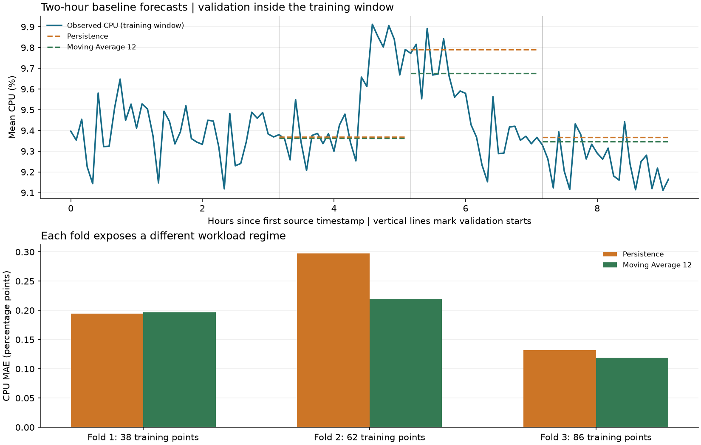

# Baseline forecasting and training-only validation

Reproduce with `python -m cwfc.backtest --data challenge_data --output reports/validation`.
This is baseline development, not final test evaluation. No final holdout
target is scored, summarized, plotted, or used to select a baseline.

## Validation design

Construct the full aggregate targets, then protect the last 24 labels.
Only the first 110 timestamps enter this evaluation. Expanding
histories start with 38 observations and advance by 24.
Every forecast is made once at its origin for all 24 future steps.
There is no updating with validation actuals during that forecast horizon.

| fold | train_n | train_start | train_end | validation_start | validation_end | validation_n | cpu_peak_threshold_pct |
| --- | --- | --- | --- | --- | --- | --- | --- |
| 1 | 38 | 0 | 11100 | 11400 | 18300 | 24 | 9.5217 |
| 2 | 62 | 0 | 18300 | 18600 | 25500 | 24 | 9.6669 |
| 3 | 86 | 0 | 25500 | 25800 | 32700 | 24 | 9.7815 |

There are 3 folds and 72 distinct scored
timestamps per model and target. The folds do not overlap. Histories expand,
so labels from an earlier fold are legitimately available at later forecast
origins. This matches repeated operational forecasting without using future
readings at any individual origin. Numeric timestamps retain their original
source-relative second units.

The three-fold default uses origins after 38, 62, and 86 observations. It
maximizes full nonoverlapping two-hour validation blocks after a history long
enough for the largest baseline window. Only three workload regimes are
available; these are limited development estimates, not independent evidence
of deployment performance or a test of daily/weekly seasonality.

## Baselines fixed before evaluation

- Persistence: repeat the last observed target value at every lead.
- Moving averages: repeat the mean of the last 3, 6, 12, 24
  readings, respectively. At five-minute cadence the default windows cover
  15, 30, 60, and 120 minutes. The forecast stays flat throughout its horizon.
- Both targets use the same folds and all models see the same histories.
- No seasonal baseline is justified by fewer than 12 hours of data.
- No metadata or source-wide CPU summaries are used as predictors.

## Metrics and units

CPU MAE, RMSE, and bias are in **percentage points**. VM-count errors are in
VMs. Bias is prediction minus actual: negative values mean underforecasting.
Pooled MAE/RMSE are calculated over individual errors, not by averaging fold
RMSE values.

Normalized MAE is the mean absolute error divided by that fold's mean absolute
training target, multiplied by 100 (`nmae_pct_training_mean`). It is not
pointwise MAPE. A zero training scale yields N/A. Relative improvement is
`100 * (1 - model_MAE / persistence_MAE)`, using pooled errors. When
persistence has zero error, improvement and the relative MAE ratio are N/A;
we do not claim a percentage improvement over a perfect baseline.

A CPU peak is an observed validation reading at or above the 90th percentile
of that fold's **training** CPU target. Thresholds are fixed at the forecast
origin; validation actuals only determine which errors are subsequently
scored as peaks. No peak points gives N/A peak metrics. Active-count peak
metrics are not used because the target is constant in this release.

## Aggregate CPU results

| model | mae | rmse | bias | nmae_pct_training_mean | mae_improvement_pct | peak_n | peak_mae | peak_bias |
| --- | --- | --- | --- | --- | --- | --- | --- | --- |
| moving_average_12 | 0.1784 | 0.2322 | 0.0373 | 1.8921 | 14.3196 | 16 | 0.2864 | -0.2848 |
| moving_average_3 | 0.1989 | 0.2515 | 0.0874 | 2.1094 | 4.4608 | 16 | 0.2446 | -0.2205 |
| moving_average_24 | 0.2077 | 0.2496 | 0.0427 | 2.2019 | 0.2228 | 16 | 0.3357 | -0.3357 |
| persistence | 0.2082 | 0.2684 | 0.0837 | 2.2078 | 0.0000 | 16 | 0.2714 | -0.2388 |
| moving_average_6 | 0.2140 | 0.2690 | 0.1113 | 2.2692 | -2.7893 | 16 | 0.2384 | -0.1986 |

The lowest pooled CPU MAE belongs to `moving_average_12`: 0.1784 percentage
points, with RMSE 0.2322. This identifies a provisional baseline
using development folds; its reported score is not an unbiased estimate after
choosing it among several windows. No final forecasting model is selected here.

Its fold-specific MAE improvements over persistence are fold 1: -0.85%, fold 2: +26.14%, fold 3: +10.06%.
A positive number means lower error; a negative number means higher error.
The pooled ranking does not imply a win in every workload regime.

For the 16 CPU peak observations, `moving_average_12` has MAE 0.2864 percentage points versus 0.2714 for persistence. Its peak bias is -0.2848, versus -0.2388 for persistence. Negative peak bias means systematic underforecasting on this subset. Overall MAE and peak risk therefore require separate assessment when choosing a capacity policy.

## Active VM count results

| model | mae | rmse | bias |
| --- | --- | --- | --- |
| persistence | 0.0000 | 0.0000 | 0.0000 |
| moving_average_3 | 0.0000 | 0.0000 | 0.0000 |
| moving_average_6 | 0.0000 | 0.0000 | 0.0000 |
| moving_average_12 | 0.0000 | 0.0000 | 0.0000 |
| moving_average_24 | 0.0000 | 0.0000 | 0.0000 |

All histories and validation blocks contain the same observed VM population.
Exact constant-count predictions reflect complete-trace cohort selection,
not demonstrated ability to forecast arrivals or departures. Persistence is
preferred on ties because it requires no window choice. No VM count is
hard-coded in the implementation.

## Fold-level CPU errors and failure analysis

| fold | model | mae | rmse | bias | peak_n | peak_mae |
| --- | --- | --- | --- | --- | --- | --- |
| 1 | persistence | 0.1947 | 0.2698 | -0.1489 | 10 | 0.3904 |
| 1 | moving_average_3 | 0.1904 | 0.2482 | -0.1049 | 10 | 0.3464 |
| 1 | moving_average_6 | 0.1904 | 0.2446 | -0.0961 | 10 | 0.3376 |
| 1 | moving_average_12 | 0.1963 | 0.2725 | -0.1539 | 10 | 0.3953 |
| 1 | moving_average_24 | 0.1919 | 0.2650 | -0.1401 | 10 | 0.3816 |
| 2 | persistence | 0.2975 | 0.3457 | 0.2827 | 6 | 0.0730 |
| 2 | moving_average_3 | 0.2795 | 0.3259 | 0.2581 | 6 | 0.0749 |
| 2 | moving_average_6 | 0.3120 | 0.3617 | 0.3021 | 6 | 0.0730 |
| 2 | moving_average_12 | 0.2197 | 0.2607 | 0.1684 | 6 | 0.1048 |
| 2 | moving_average_24 | 0.1727 | 0.1993 | 0.0096 | 6 | 0.2592 |
| 3 | persistence | 0.1324 | 0.1542 | 0.1172 | 0 | N/A |
| 3 | moving_average_3 | 0.1269 | 0.1480 | 0.1089 | 0 | N/A |
| 3 | moving_average_6 | 0.1396 | 0.1626 | 0.1281 | 0 | N/A |
| 3 | moving_average_12 | 0.1191 | 0.1396 | 0.0973 | 0 | N/A |
| 3 | moving_average_24 | 0.2587 | 0.2774 | 0.2587 | 0 | N/A |

Flat forecasts cannot anticipate a workload change that begins after their
origin. Persistence can amplify an unusually high or low final reading;
averaging can stabilize such noise but can also lag a recent demand change.
Use the fold rows and signed bias to distinguish underprediction during a
rise from overprediction after a decline. Peak errors expose whether average
accuracy conceals under-provisioning risk.

`baseline_predictions.csv` preserves every scored prediction, origin, lead,
actual value, training scale, and peak flag for inspection. All actuals in
that file belong to development validation, not the protected final holdout.
`baseline_horizon_metrics.csv` gives lead-specific results, with only
3 errors per model/target/lead. That sample is too small to establish
a reliable horizon-dependent uncertainty interval.

## What this stage supports

These results establish a reproducible reference for later CPU modeling.
Compare any additional model with persistence and the strongest moving
average using these same chronological folds. Freeze the final method and
parameters before generating and scoring the two-hour public holdout.
Capacity margins should be assessed using signed/peak forecast errors and
the consequences of under-provisioning, rather than low mean utilization
alone. This baseline experiment does not yet justify a calibrated uncertainty
band, a concrete scaling threshold, or generalization to a changing VM fleet.
