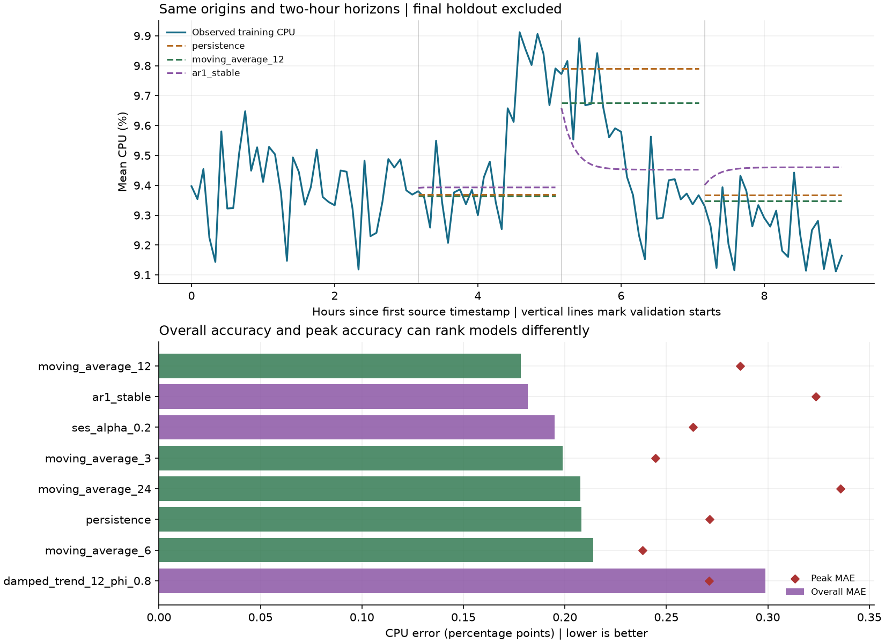

# Simple CPU model comparison

Reproduce with `python -m cwfc.compare --data challenge_data --output reports/validation`.
All results use development validation inside the first 110 timestamps.
The final 24 observed target values are not used to fit, tune, select,
score, plot, or summarize these models. They are not exported.

## Experiment fixed before scoring

Three new candidates are compared with persistence and the original four
moving-average baselines. Smoothing, trend, and autoregression parameters
were fixed before running this comparison; there is no hyperparameter search
or adjustment after inspecting scores. CPU clipping to [0, 100] is applied
by each candidate as a physical constraint. No new dependencies are required.

The primary ranking remains pooled MAE, as in baseline development. RMSE,
peak MAE, signed bias, and fold-level failures are reported separately rather
than silently changing the objective to favor a new model. These reused
development folds are not an unbiased final performance estimate after
model selection. With only 3 origins, small score
differences cannot establish statistically reliable superiority.

## Candidate definitions and information availability

1. **Simple exponential smoothing, alpha = 0.2.** Initialize the level at the
   first training reading and recursively update
   `level = 0.2 * reading + 0.8 * previous_level`. Forecast the final level at
   every lead. Alpha is fixed, not estimated using validation or holdout data.
2. **Local damped trend, 12 observations, damping = 0.8.** Fit an ordinary
   least-squares line to the last hour of history using observation indices.
   Forecast lead h as `fitted_last_level + slope * sum(0.8**j, j=1..h)`.
   Geometric damping limits extrapolated drift to four times the fitted slope
   as the horizon grows. This is a local regression model, not fitted Holt
   exponential smoothing. Its level and slope are refitted at each origin.
3. **Stable AR(1).** Fit `y[t] = intercept + phi*y[t-1]` by least squares on
   that fold's history. Restrict phi to [-0.95, 0.95] and recompute the
   intercept as `mean(y) - phi*mean(lagged_y)`. Forecast recursively from the
   last observed value, feeding predictions rather than actual future values
   into later leads. Constant histories fall back to persistence.

The fixed smoothing and damping values are deliberately modest defaults for
a short data window, not claimed optimum parameters. No daily/weekly calendar
features, metadata CPU summaries, deletion times, or future VM measurements
are used. Numeric timestamps stay in source-relative seconds; future lead
indices are known at forecast origin. The active-VM-count target continues
to use the baseline methods; the new candidates are CPU-only.

## Exactly the same validation protocol

| fold | train_n | train_start | train_end | validation_start | validation_end | validation_n | cpu_peak_threshold_pct |
| --- | --- | --- | --- | --- | --- | --- | --- |
| 1 | 38 | 0 | 11100 | 11400 | 18300 | 24 | 9.5217 |
| 2 | 62 | 0 | 18300 | 18600 | 25500 | 24 | 9.6669 |
| 3 | 86 | 0 | 25500 | 25800 | 32700 | 24 | 9.7815 |

These are the original nonoverlapping expanding folds: the default histories
contain 38, 62, and 86 observations, each forecasting the next 24. There are
72 scored timestamps per CPU model.
Predictions for the complete horizon are made before validation values are
used for scoring. The baseline and candidate paths share the same evaluation
function, training scales, peak thresholds, and metric definitions.

CPU peaks are validation actuals at or above the 90th percentile of CPU in
that fold's training history. Thresholds are fixed at each forecast origin.
MAE/RMSE/bias/peak errors use **percentage points**; bias is prediction minus
actual. Normalized MAE is the mean of each absolute error divided by its
fold's mean absolute training target, times 100. It avoids pointwise near-zero
denominators; zero training scale is N/A. Relative improvements are N/A when
the reference error is zero. Positive improvement means lower error.

## CPU results

| model | mae | rmse | bias | nmae_pct_training_mean | mae_improvement_pct | mae_improvement_vs_best_baseline_pct | peak_mae | peak_bias |
| --- | --- | --- | --- | --- | --- | --- | --- | --- |
| moving_average_12 | 0.1784 | 0.2322 | 0.0373 | 1.8921 | 14.3196 | 0.0000 | 0.2864 | -0.2848 |
| ar1_stable | 0.1817 | 0.2243 | 0.0150 | 1.9262 | 12.7430 | -1.8401 | 0.3236 | -0.3236 |
| ses_alpha_0.2 | 0.1948 | 0.2462 | 0.0738 | 2.0662 | 6.4140 | -9.2269 | 0.2631 | -0.2481 |
| moving_average_3 | 0.1989 | 0.2515 | 0.0874 | 2.1094 | 4.4608 | -11.5065 | 0.2446 | -0.2205 |
| moving_average_24 | 0.2077 | 0.2496 | 0.0427 | 2.2019 | 0.2228 | -16.4528 | 0.3357 | -0.3357 |
| persistence | 0.2082 | 0.2684 | 0.0837 | 2.2078 | 0.0000 | -16.7128 | 0.2714 | -0.2388 |
| moving_average_6 | 0.2140 | 0.2690 | 0.1113 | 2.2692 | -2.7893 | -19.9683 | 0.2384 | -0.1986 |
| damped_trend_12_phi_0.8 | 0.2987 | 0.3814 | 0.2144 | 3.1661 | -43.4721 | -67.4503 | 0.2711 | -0.0987 |

Best original baseline by MAE: `moving_average_12` (0.1784).
Best new candidate by MAE: `ar1_stable` (0.1817).
Lowest RMSE across all methods: `ar1_stable` (0.2243).

None of the three new candidates improves the primary pooled MAE over `moving_average_12`. Retain that baseline as the provisional point-forecast choice for a mean-absolute-error objective. Adding a model is not itself evidence of improvement.

There are 16 peak observations across these folds. The strongest new candidate by MAE (`ar1_stable`) has peak MAE 0.3236 and peak bias -0.3236 percentage points, versus 0.2864 and -0.2848 for the strongest baseline. Negative peak bias means underforecasting. A lower overall RMSE does not establish lower peak risk.

## Stability across origins and failure modes

| model | fold_1_mae | fold_2_mae | fold_3_mae |
| --- | --- | --- | --- |
| ar1_stable | 0.1903 | 0.1508 | 0.2039 |
| damped_trend_12_phi_0.8 | 0.1886 | 0.5458 | 0.1617 |
| moving_average_12 | 0.1963 | 0.2197 | 0.1191 |
| moving_average_24 | 0.1919 | 0.1727 | 0.2587 |
| moving_average_3 | 0.1904 | 0.2795 | 0.1269 |
| moving_average_6 | 0.1904 | 0.3120 | 0.1396 |
| persistence | 0.1947 | 0.2975 | 0.1324 |
| ses_alpha_0.2 | 0.1904 | 0.2554 | 0.1387 |

The AR(1) model regresses forecasts toward an estimated long-run level. It
can handle a decline after a peak better than holding the latest high value,
but an expanding-history level can remain above a later low-load regime.
Smoothing reduces sensitivity to the last observation but cannot anticipate
new demand. Local trend extrapolation can continue a rise into a reversal.

The damped-trend candidate's largest fold error occurs in fold 2:
MAE 0.5458, with bias +0.5458 percentage points. The sign
of that bias identifies the direction of the failure. Damping limits the size
of extrapolation; it cannot identify a future regime change. The full signed
errors are retained in the prediction CSV rather than hidden by an average.

## Decision and limitations

None of the three new candidates improves the primary pooled MAE over `moving_average_12`. Retain that baseline as the provisional point-forecast choice for a mean-absolute-error objective. Adding a model is not itself evidence of improvement.

For an operational policy, distinguish the point-forecast objective from the
cost of underpredicting peaks. A model's RMSE or overall MAE alone cannot
justify its capacity margin. Only a small number of peaks and forecast
origins are observed, so no calibrated uncertainty coverage or population-wide
generalization is established here. Active-count errors remain zero for all
baseline methods because this release selects a complete-trace VM cohort.

The comparison does not generate final holdout predictions or evaluate final
test accuracy. After agreeing the forecasting objective and operational
headroom policy, freeze the method and parameters, refit on all public
training observations, and generate the required prediction file. Final
holdout scoring should follow that freeze, without further tuning.

Outputs preserve model configuration, fold definitions, training-only
validation predictions, overall/fold/lead metrics, and this report. For tiny
smoke inputs, the command accepts `--train-size`, `--horizon`,
`--min-train-size`, and `--windows`; the initial history must still fit the
fixed 12-observation trend candidate. Nothing fixes VM count or CPU values.
